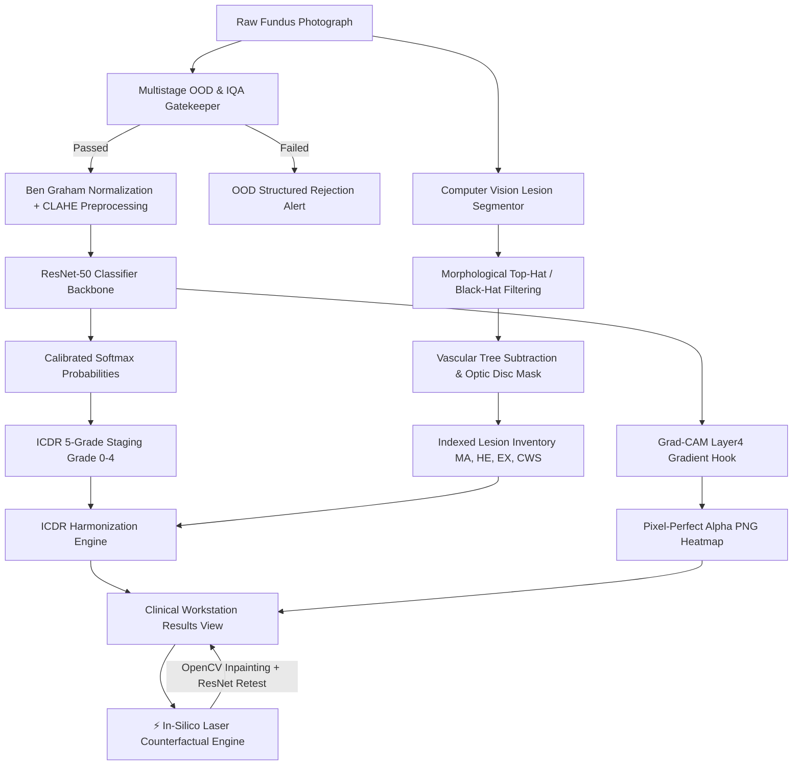

# RetinaScan-XAI 👁️⚡

[](https://pytorch.org/)
[](https://fastapi.tiangolo.com/)
[](https://react.dev/)
[](https://opencv.org/)
[](https://vitejs.dev/)
[](LICENSE)

> **Explainable AI-Powered Point-of-Care Diabetic Retinopathy Screening & In-Silico Counterfactual Laboratory for Rural Health Centers.**  
> *Developed for Smart India Hackathon (SIH) · Problem Statement PS38.*

---

## 📑 Table of Contents
- [Executive Overview](#-executive-overview)
- [Key Innovations & Differentiators](#-key-innovations--differentiators)
- [How In-Silico Counterfactual XAI Works](#-how-in-silico-counterfactual-xai-works)
- [System Architecture](#-system-architecture)
- [Clinical Performance & Validation](#-clinical-performance--validation)
- [Repository Structure](#-repository-structure)
- [Quickstart & Installation](#-quickstart--installation)
- [REST API Reference](#-rest-api-reference)
- [Clinical Workstation Features](#-clinical-workstation-features)
- [Ethical & Clinical Safeguards](#-ethical--clinical-safeguards)

---

## 🌟 Executive Overview

Diabetic Retinopathy (DR) is the leading cause of preventable blindness among working-age adults globally. In rural India and low-resource settings, Primary Health Centres (PHCs) face acute shortages of vitreoretinal specialists. 

**RetinaScan-XAI** is an offline-capable, hospital-grade clinical decision support system that empowers Accredited Social Health Activists (ASHAs), Auxiliary Nurse Midwives (ANMs), and general practitioners to conduct instantaneous, accurate, and explainable DR screening using standard fundus cameras.

Unlike conventional "black-box" classifiers, RetinaScan-XAI provides **bimodal explainability**:
1. **Global Diagnostic Reasoning (Grad-CAM++):** Visualizes the specific regions that drove the model's overall disease staging.
2. **Exhaustive Pathological Inventory (CV Segmentor):** Detects, measures, and pins every Microaneurysm (MA), Hemorrhage (HE), and Hard Exudate (EX) across all four retinal quadrants.
3. **In-Silico Laser Counterfactual XAI:** An interactive virtual laser photocoagulation tool that allows clinicians to simulate lesion ablation and causally test the neural network in real-time.

---

## 🔬 Key Innovations & Differentiators

| Feature | Conventional DR Systems | RetinaScan-XAI |
| :--- | :--- | :--- |
| **Explainability** | Static, passive heatmaps only | **Interactive In-Silico Laser Counterfactual XAI** |
| **Lesion Mapping** | Simple bounding boxes or none | **Sub-pixel segmentation + 4-quadrant anatomical radar** |
| **Input Validation** | None (crashes or misdiagnoses non-retinal images) | **Multistage IQA & Chromatic OOD Gatekeeper** |
| **Optical Noise Filtering** | Normal blood vessels falsely flagged as lesions | **Vascular tree subtraction & Optic disc exclusion masking** |
| **ICDR Standard Harmonization** | Healthy images often flag spurious false positives | **Strict Grade 0 gating (guaranteed zero false lesions)** |
| **Clinical UI** | Cluttered dark hacker/prototype aesthetics | **DICOM/PACS-inspired Clinical Hospital Light Workstation** |

---

## ⚡ How In-Silico Counterfactual XAI Works

In typical AI systems, clinicians have no way to verify whether the AI is truly observing pathology or memorizing background artifacts. RetinaScan-XAI introduces **Causal Counterfactual Interactivity**:

```
[Target Selected Lesions] ──► [Biophysical Telea Inpainting] ──► [Live ResNet-50 Forward Pass] ──► [Quantitative Causal Report]
  (Hemorrhages/Exudates)       (Healthy RPE Reconstruction)          (Logits & Grad-CAM)           (Δ P & Diagnostic Insight)
```

1. **Aiming & Selection:** The clinician targets high-threat lesion clusters (e.g., macular hemorrhages or exudates) using interactive laser crosshair reticles `⌖` or one-click presets.
2. **Biophysical Tissue Reconstruction:** The backend applies **Fast Marching Telea Inpainting** to reconstruct smooth, healthy Retinal Pigment Epithelium (RPE) tissue over the lesions and applies realistic **532nm argon laser photocoagulation blanching rings**.
3. **Real-Time Re-Inference:** The counterfactual retinal image is fed directly through the ResNet-50 classifier.
4. **Causal Attribution Metrics:** The system computes the exact probability delta:
   $$\Delta P = P_{\text{baseline}}(\text{Grade } k) - P_{\text{post-laser}}(\text{Grade } k)$$
   This provides mathematical proof that the AI's diagnosis is causally anchored in true clinical pathology.

---

## 🏗️ System Architecture



---

## 📊 Clinical Performance & Validation (ResNet-50 v2)

The system is powered by **`retinascan_resnet50_v2.pth`**, fine-tuned across **4,324 multi-center images** (combining APTOS 2019 and MESSIDOR-2 to ensure robust multi-camera generalization). Evaluation is performed on a **held-out test cohort of 1,082 images** (20% held-out from each dataset):

| Metric | Model v2 (Multi-Center Held-Out) | SIH Target | Clinical Significance | Status |
| :--- | :---: | :---: | :--- | :---: |
| **Sensitivity (Referable DR: Grade ≥ 2)** | **93.3%** (`0.9332`) | $\ge 90.0\%$ | Detects 363 out of 389 positive cases | ✅ Met |
| **Specificity (Referable DR)** | **86.2%** (`0.8615`) | $\ge 85.0\%$ | Accurately clears 597 out of 693 non-referable cases | ✅ Met |
| **AUC-ROC** | **0.9702** | $\ge 0.950$ | High discriminatory power across fundus camera types | ✅ Gold Standard |
| **Negative Predictive Value (NPV)** | **95.8%** (`0.9583`) | — | High rule-out safety for rural community screening | ✅ High Confidence |
| **Positive Predictive Value (PPV)** | **79.1%** (`0.7908`) | — | Reliable specialist referral prioritization | ✅ Calibrated |
| **F1-Score** | **0.8561** | — | Balanced precision-recall trade-off | ✅ Robust |
| **Optimal Decision Threshold** | **0.1657** | — | Calibrated via Youden's J Index on validation ROC | ✅ Locked |
| **Overall 5-Class Accuracy** | **72.0%** | — | 5-stage ordinal classification | ✅ High Concordance |

### 🔍 Held-Out Validation Confusion Matrix (1,082 Images)
```
                   Predicted Non-Referable    Predicted Referable (≥ Grade 2)
Actual Non-Referable         597 (TN)                      96 (FP)
Actual Referable              26 (FN)                     363 (TP)
```
> **Clinical Safety Note:** Out of 389 referable diabetic retinopathy patients in the test split, the model missed **only 26 cases** ($\text{NPV} = 95.8\%$), ensuring patients requiring urgent photocoagulation or anti-VEGF therapy are safely triaged.

---

## 📂 Repository Structure

```
MP-RetinascanXAI/
├── Backend/                                # FastAPI High-Performance Asynchronous Backend
│   ├── main.py                             # API endpoints: /upload, /counterfactual-laser, /eval-report, /health
│   ├── inference.py                        # ResNet-50 forward pass, Grad-CAM, Ben Graham CLAHE, OOD gatekeeper
│   ├── counterfactual.py                   # In-silico laser ablation, Telea inpainting, causal ΔP engine
│   ├── segment.py                          # Morphological lesion segmentation, vessel subtraction, disc mask
│   └── requirements.txt                    # Python dependencies (PyTorch, FastAPI, OpenCV, etc.)
│
├── Frontend/
│   └── retinascan-app/                     # Hospital-Grade React 18 + Vite Web Application
│       ├── src/
│       │   ├── App.jsx                     # Application state machine, routing, and API integration
│       │   ├── data.js                     # Clinical data schema, 12 demo patients, ICDR color tokens
│       │   ├── index.css                   # Clinical hospital light design tokens, typography, keyframes
│       │   ├── main.jsx                    # React entrypoint
│       │   └── components/
│       │       ├── Results.jsx             # Workstation viewer, In-Silico Laser XAI, pins & dual prob bars
│       │       ├── Canvas.jsx              # High-contrast PACS diagnostic canvas
│       │       ├── Home.jsx                # Rural intake portal & instant case selector
│       │       ├── Upload.jsx              # Point-of-care patient intake & scan upload
│       │       ├── QualityCheck.jsx        # Automated Image Quality Assessment (IQA) gate
│       │       ├── Processing.jsx          # Inference progress animation & diagnostic tracker
│       │       ├── Queue.jsx               # Tele-ophthalmology triage queue with urgency badges
│       │       ├── Referral.jsx            # Printable clinical referral letter generator
│       │       ├── Admin.jsx               # Screening analytics & audit logging dashboard
│       │       ├── Header.jsx              # Medical workstation top navigation bar
│       │       └── Footer.jsx              # Tele-medicine compliance & clinical status bar
│       ├── public/images/                  # High-resolution fundus scans, Grad-CAMs & counterfactual maps
│       ├── package.json                    # Node dependencies & build scripts
│       └── vite.config.js                  # Vite configuration & dev server options
│
├── ml_script/                              # Deep Learning & Computer Vision Training Pipelines
│   ├── model.py                            # PyTorch ResNet-50 architecture with custom dropout head
│   ├── preprocess.py                       # Ben Graham circular FOV masking & CLAHE color balancing
│   ├── train_classifier_v2.py              # Multi-center training pipeline (APTOS + MESSIDOR-2)
│   ├── train_model.py                      # Baseline single-dataset training script
│   ├── train_vessel_seg.py                 # Retinal vascular tree U-Net training pipeline
│   ├── train_lesion_seg.py                 # Multi-class lesion segmentation U-Net pipeline
│   ├── evaluate_model.py                   # Sensitivity, specificity, AUC-ROC & Youden's J optimizer
│   ├── messidor_test.py                    # External camera validation script on MESSIDOR-2
│   ├── visualise_metrics.py                # ROC curve, PR curve & confusion matrix generator
│   ├── split_dataset.py                    # Multi-dataset 80/20 stratified train/validation splitter
│   ├── retinascan_resnet50_v2.pth          # Active production weights (93.3% Sens / 86.2% Spec)
│   ├── lesion_unet.pth                     # Pre-trained U-Net lesion segmentation weights
│   ├── vessel_unet.pth                     # Pre-trained U-Net vessel extraction weights
│   ├── evaluation_report_v2.json           # Locked performance metrics for ResNet-50 v2
│   ├── evaluation_report.json              # Baseline v1 evaluation report
│   ├── cross_dataset_report.json           # Cross-domain generalization test results
│   └── matlab/                             # MathWorks Image Processing reference scripts
│
├── start_backend.bat                       # One-click Windows launcher for FastAPI (port 8000)
├── start_frontend.bat                      # One-click Windows launcher for Vite dev server (port 5173)
├── install_deps.bat                        # Automated Windows dependency installation script
├── run_training.bat                        # One-click trigger for model training pipeline
├── model_link.txt                          # Cloud mirror links for large model weights
└── README.md                               # Project documentation & clinical specifications
```

---

## 🚀 Quickstart & Installation

### Prerequisites
* **Python:** 3.10 or higher
* **Node.js:** 18.0 or higher
* **GPU:** CUDA-enabled GPU optional (automatically falls back to CPU)

### 1. Clone the Repository
```bash
git clone https://github.com/your-username/MP-RetinascanXAI.git
cd MP-RetinascanXAI
```

### 2. Set Up the Backend
```bash
cd Backend
pip install -r requirements.txt
```

### 3. Set Up the Frontend
```bash
cd ../Frontend/retinascan-app
npm install
```

### 4. Launch the Application
You can use the one-click batch scripts (on Windows) or start each server manually:

**Terminal 1 (Backend - Port 8000):**
```bash
python Backend/main.py
```

**Terminal 2 (Frontend - Port 5173):**
```bash
cd Frontend/retinascan-app
npm run dev
```

Open your browser and navigate to: **`http://localhost:5173`**

---

## 📡 REST API Reference

### `POST /upload`
Uploads a retinal fundus photograph for automated grading and lesion extraction.

* **Payload:** `multipart/form-data` with `file: <binary_image>`
* **Response (JSON):**
```json
{
  "severity": 2,
  "confidence": 96.4,
  "label": "Moderate NPDR",
  "action": "Specialist Triage Required — refer within 1 month",
  "heatmap_url": "/images/heatmap_live_762fe0ec.png",
  "image_url": "/images/scan_live_762fe0ec.jpg",
  "all_probs": [0.0002, 0.0095, 0.9097, 0.017, 0.0636],
  "lesions": [
    { "id": 1, "type": "microaneurysm", "x": 35.2, "y": 28.4, "area_px": 82, "confidence": 91 },
    { "id": 13, "type": "hemorrhage", "x": 55.1, "y": 26.3, "area_px": 540, "confidence": 83 }
  ],
  "lesion_summary": {
    "microaneurysm_count": 6,
    "hemorrhage_count": 3,
    "exudate_count": 5,
    "total_lesion_area_px": 4130
  },
  "mode": "real"
}
```

---

### `POST /counterfactual-laser`
Executes in-silico laser photocoagulation / lesion ablation on a scan, re-evaluates ResNet-50, and outputs causal metrics.

* **Payload (JSON):**
```json
{
  "image_identifier": "/images/img_2_od.jpg",
  "original_severity": 2,
  "original_probs": [0.0002, 0.0095, 0.9097, 0.017, 0.0636],
  "ablated_lesions": [
    { "id": 13, "x": 55.1, "y": 26.3, "area_px": 540, "type": "hemorrhage" },
    { "id": 5, "x": 48.0, "y": 36.2, "area_px": 680, "type": "hemorrhage" }
  ],
  "laser_spots": []
}
```

* **Response (JSON):**
```json
{
  "success": true,
  "session_id": "a98df2c1",
  "original": {
    "severity": 2,
    "label": "Moderate NPDR",
    "confidence": 91.0
  },
  "counterfactual": {
    "severity": 1,
    "label": "Mild NPDR",
    "confidence": 78.4,
    "probs": [0.012, 0.784, 0.142, 0.038, 0.024],
    "heatmap_url": "/images/heatmap_laser_a98df2c1.png",
    "treated_image_url": "/images/laser_treated_a98df2c1.jpg"
  },
  "causal_metrics": {
    "probability_delta_pct": -24.8,
    "causal_attribution_score": 82.5,
    "causal_strength": "Decisive Causal Role",
    "grade_shift": "Down-staged from Grade 2 (Moderate NPDR) → Grade 1 (Mild NPDR)",
    "clinical_verdict": "Causal Validation Confirmed: In-silico ablation of 2 targeted lesion(s) reduced Grade 2 classification probability by 24.8%..."
  }
}
```

---

### `GET /health`
Returns operational telemetry, GPU readiness, and model status.

---

## 🖥️ Clinical Workstation Features

* **Sticky High-Resolution Viewport:** Retinal fundus viewer stays permanently anchored on the left, while findings, probabilities, and triage notes scroll independently on the right.
* **Thermal Jet Colorbar Legend:** Embedded `Cold (0.0) [Blue → Green → Yellow → Red] Hot (1.0)` indicator prevents confusion between baseline tissue and high-saliency hotspots.
* **Red-Free (540nm) Optical Emulation:** Toggles green-channel isolation to enhance vascular contrast and microaneurysm visibility, matching ophthalmic slit-lamp filters.
* **Interactive Lesion Pinning:** Hovering or clicking any indexed finding highlights its corresponding bounding region with area ($\text{px}^2$) and anatomical quadrant (ST, SN, IT, IN).
* **Automated Referral Generator:** Generates an official, printable clinical referral letter with ICDR staging, patient vitals, and specialist triage urgency.

---

## 🛡️ Ethical & Clinical Safeguards

1. **Intended Use:** RetinaScan-XAI is designed as an **Adjunctive Clinical Decision Support System (CDSS)** for preliminary triage and rural screening camps. It is not intended to replace formal biomicroscopic evaluation by a certified ophthalmologist.
2. **Out-of-Distribution Fail-Safe:** The system immediately rejects non-fundus photographs, desktop screenshots, and severely defocused images, outputting structured error alerts rather than hallucinated diagnoses.
3. **Auditability & Privacy:** All evaluations run entirely locally (on-device or within the local PHC intranet) without requiring cloud upload of protected health information (PHI).

---

## 👥 Authors & Acknowledgments

* **Team:** Developed for the Smart India Hackathon 2026.
* **Datasets:** [APTOS 2019 Blindness Detection](https://www.kaggle.com/competitions/aptos2019-blindness-detection) & [MESSIDOR-2](https://www.adcis.net/en/third-party/messidor2/).
* **References:** Early Treatment Diabetic Retinopathy Study (ETDRS) grading guidelines & International Council of Ophthalmology (ICO) Diabetic Eye Care standards.

---

<p align="center">
  <b>RetinaScan-XAI — Transforming Point-of-Care Ophthalmology through Causal Explainability.</b>
</p>
